

  <a href="https://github.com/ekinboztepe/cipherforest"></a>
  <a href="https://github.com/ekinboztepe/vizdoom-rl-project"></a>
  <a href="#behind-closed-doors"></a>
  <a href="https://github.com/ekinboztepe/project-odyssey"></a>
  <a href="#behind-closed-doors"></a>
  <a href="#behind-closed-doors"></a>
  <a href="#behind-closed-doors"></a>
  <a href="https://github.com/ekinboztepe/project-legit"></a>

### I'm Ekin. I make models smart and servers clueless.

Machine learning, and the products around it. Every project I care about gets a sigil: 8×8 pixels, one bit each. 64 bits of identity, none wasted.

How to read a sigil

 

Each row is one byte. Lit pixel is 1, dark pixel is 0. Here's cipherforest:

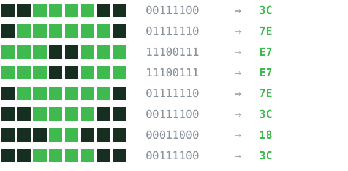

Read the bytes top to bottom and you get `0x3C7EE7E77E3C183C`. That number is the logo. Every sigil above decodes the same way.

<!-- now:start -->
 &nbsp;**Now building:** cipherforest, last push last week.
<!-- now:end -->

## Projects

<a href="https://github.com/ekinboztepe/cipherforest">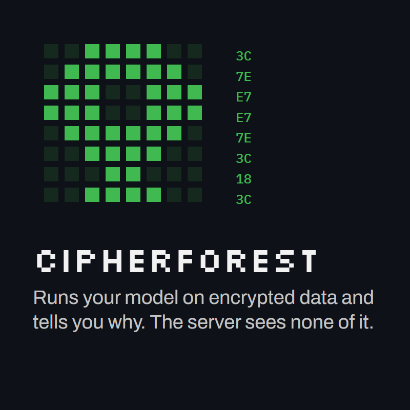</a>
<a href="https://github.com/ekinboztepe/vizdoom-rl-project">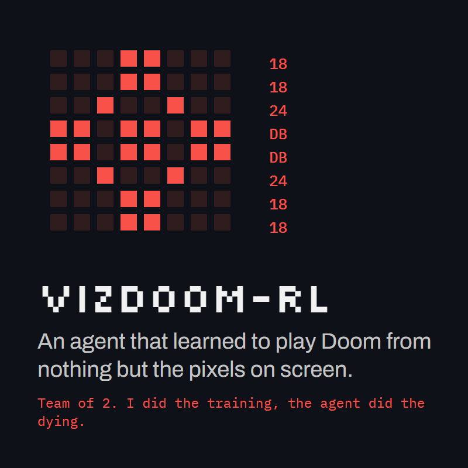</a>
<a href="https://github.com/ekinboztepe/project-odyssey">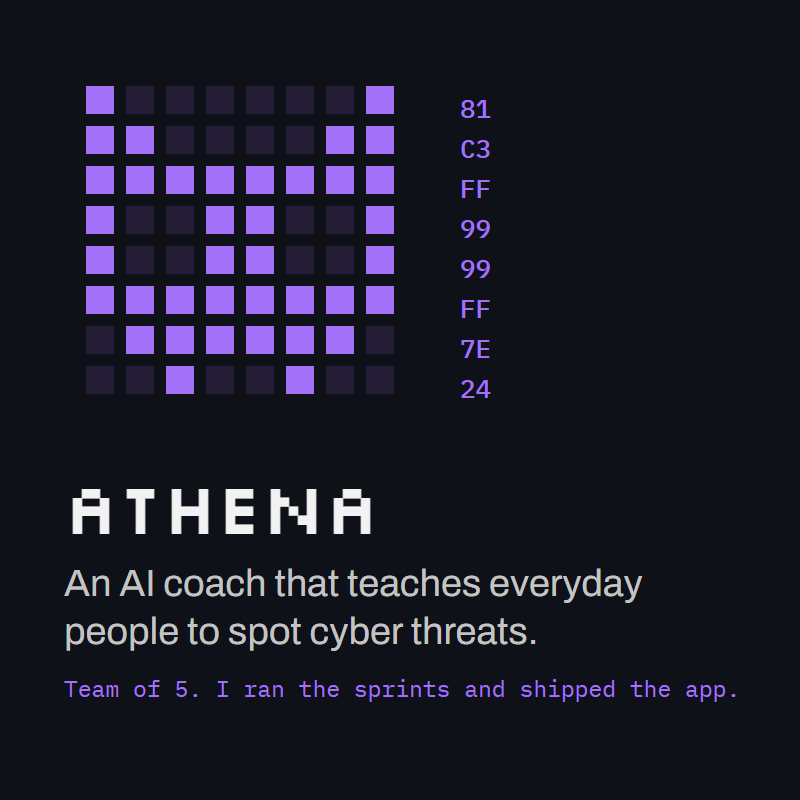</a>
<a href="https://github.com/ekinboztepe/project-legit">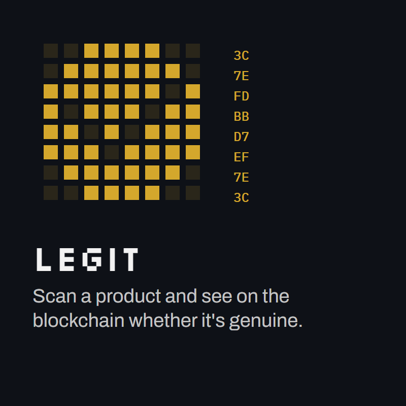</a>

## Behind closed doors

Private for now. The sigils are public, though.

<table>
  <tr><td align="center"></td><td><b>milk10k</b></td><td>Reads dermoscopy images, with extra care for the skin tones most datasets underrepresent.</td></tr>
  <tr><td align="center"></td><td><b>nexus</b></td><td>A hub for finding people to play co-op games with.</td></tr>
  <tr><td align="center"></td><td><b>retrocloud</b></td><td>Classic games in the browser, each player in their own cloud container.</td></tr>
  <tr><td align="center"></td><td><b>applistingkit</b></td><td>Turns app screenshots into store-ready listing images. No sign-up.</td></tr>
</table>

<!-- calendar:start -->
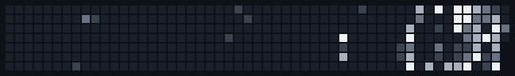

577 contributions in the last year. One LED per day.
<!-- calendar:end -->

## Ping me

[LinkedIn](https://www.linkedin.com/in/ekinboztepe/)
