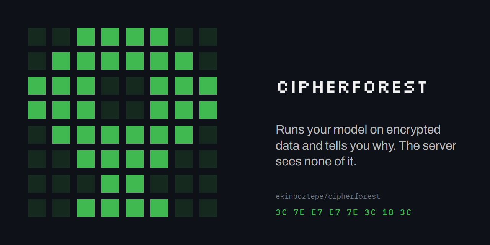
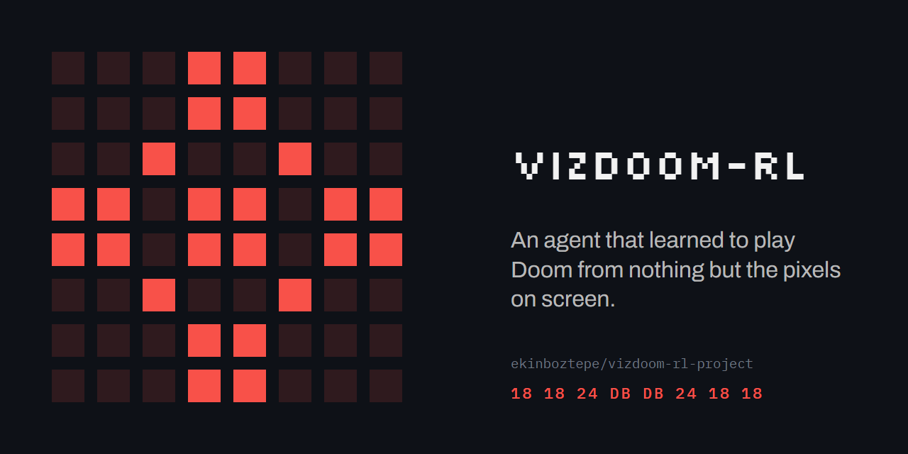
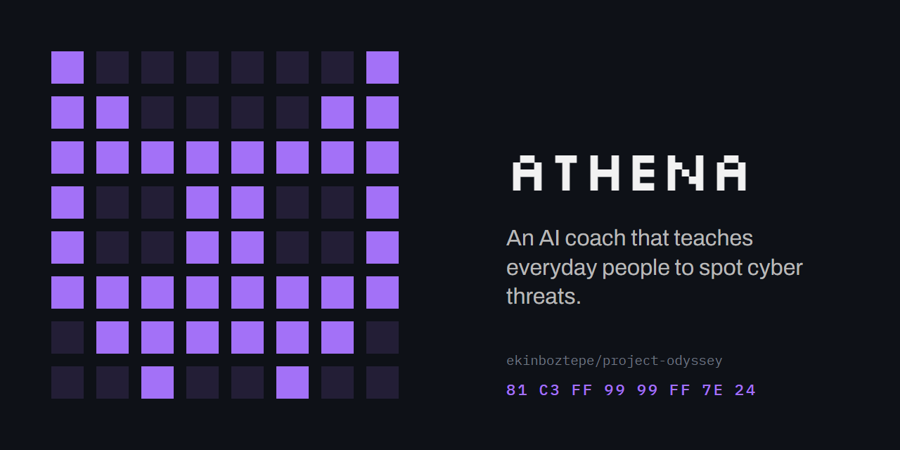
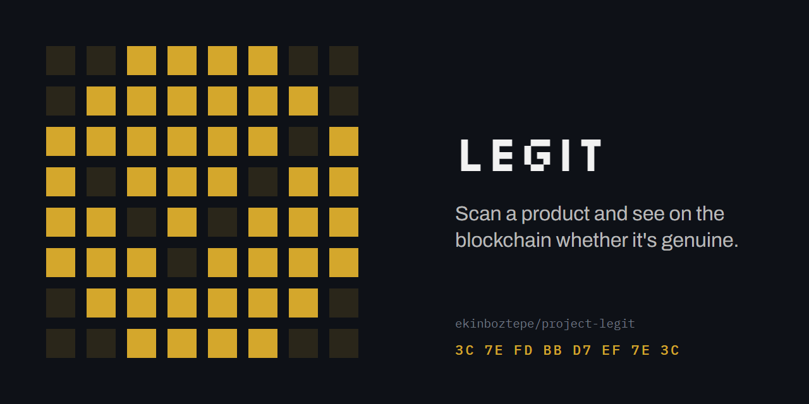

  

### I'm Ekin. I make models smart and servers clueless.

Machine learning, and the products around it.
Every project I care about gets a sigil: 8×8 pixels, one bit each. 64 bits of identity, none wasted.

## Projects

## Behind closed doors

Private for now. The sigils are public, though.

<table>
  <tr><td align="center"></td><td><b>milk10k</b></td><td>Reads dermoscopy images, with extra care for the skin tones most datasets underrepresent.</td></tr>
  <tr><td align="center"></td><td><b>nexus</b></td><td>A hub for finding people to play co-op games with.</td></tr>
  <tr><td align="center"></td><td><b>retrocloud</b></td><td>Classic games in the browser, each player in their own cloud container.</td></tr>
  <tr><td align="center"></td><td><b>applistingkit</b></td><td>Turns app screenshots into store-ready listing images. No sign-up.</td></tr>
</table>

## Ping me

[LinkedIn](https://www.linkedin.com/in/ekinboztepe/)
